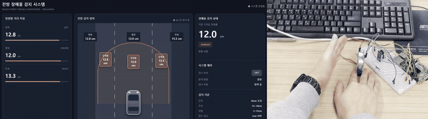
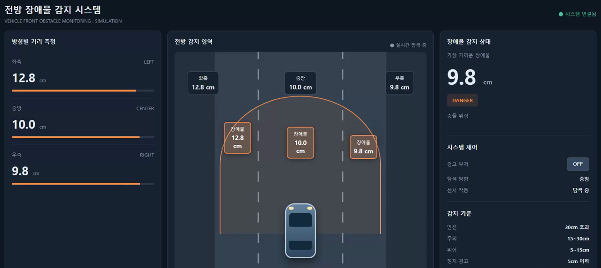
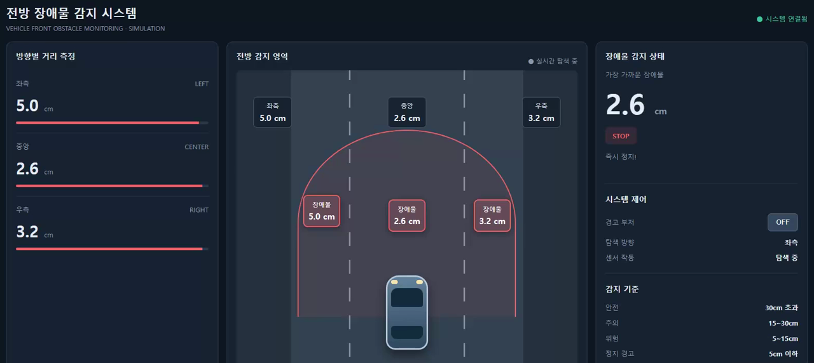
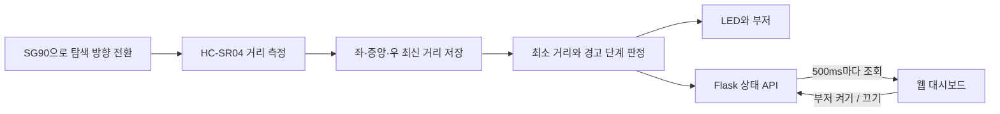
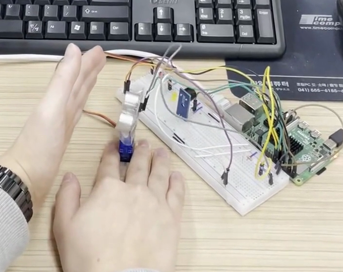

# 🚗 전방 장애물 감지 시스템

**초음파 센서 하나로 좌측·중앙·우측을 탐색하고, 장애물 거리에 따라 웹 화면과 LED·부저로 경고하는 Raspberry Pi 개인 프로젝트입니다.**


[시연 영상](#-시연-영상) · [직접 구현한 기능](#-직접-구현한-기능) · [감지 기준](#-거리별-감지-기준) · [실행 방법](#-실행-방법)

## 🎬 시연 영상

[](demo/obstacle-detection.mp4)

[▶ 전체 시연 영상 보기](demo/obstacle-detection.mp4) · 28초

센서에 손을 가까이 대면 방향별 거리와 가장 가까운 장애물의 거리가 바뀝니다. 대시보드가 거리 기준에 따라 주의·위험·정지 경고를 표시하는 모습을 실제 장치와 함께 볼 수 있습니다.

| `DANGER` · 9.8cm | `STOP` · 2.6cm |
| :---: | :---: |
|  |  |

## 🛠 직접 구현한 기능

**개발자 조영준 · 개인 프로젝트**

| 기능 | 구현 내용 |
| --- | --- |
| 방향별 거리 측정 | SG90 서보모터로 HC-SR04를 **좌(−90°) → 중앙(0°) → 우(+90°) → 중앙(0°)** 순서로 돌립니다. 센서가 안정된 뒤 거리를 cm로 저장합니다. |
| 가장 가까운 장애물 판정 | 방향별 최신 유효 측정값 중 최솟값을 선택합니다. Flask 서버는 거리 기준에 따라 경고 상태와 안내 문구를 결정합니다. |
| 물리 경고 | 노란색과 빨간색 LED로 경고를 구분하고, 부저는 단계에 따라 다른 주기와 음높이로 울립니다. 센서 방향을 바꾸는 대기 구간에도 경고 상태를 갱신합니다. |
| 웹 대시보드 | JavaScript가 500ms 간격으로 상태 API를 조회합니다. 방향별 거리, 탐색 방향, 가장 가까운 거리를 표시하고, 30cm 이내의 장애물을 도로 모식도에 표시합니다. |
| 부저 제어 | 대시보드에서 부저를 켜고 끌 수 있습니다. 부저를 꺼도 거리 표시는 계속 갱신됩니다. |

## 📏 거리별 감지 기준

아래 거리 기준은 장치 시연에 사용한 값입니다. 화면의 차량은 탐색 방향을 보여 주는 모식도이며, `STOP`은 **정지 경고**를 뜻합니다.

| 가장 가까운 유효 거리 | 화면 상태 | LED | 부저가 켜져 있을 때 |
| --- | --- | --- | --- |
| 30cm 초과 | `SAFE` · 안전 | 꺼짐 | 꺼짐 |
| 15cm 초과 ~ 30cm 이하 | `CAUTION` · 장애물 주의 | 노란색 | 440Hz · 느리게 반복 |
| 5cm 초과 ~ 15cm 이하 | `DANGER` · 충돌 위험 | 빨간색 | 660Hz · 빠르게 반복 |
| 5cm 이하 | `STOP` · 즉시 정지 경고 | 빨간색 | 880Hz · 연속음 |
| 유효한 측정값 없음 | `ERROR` · 거리 측정 불가 | 꺼짐 | 꺼짐 |

코드에서는 199cm 이상이나 측정 예외를 유효한 거리에서 제외합니다. 이 시스템은 차량 전방 감지를 실험하기 위한 프로토타입입니다.

## 🔄 시스템 구성



| API | 설명 |
| --- | --- |
| `GET /` | 대시보드 페이지 |
| `GET /api/status` | 방향별 거리, 센서 방향, 최소 거리, 경고 단계와 부저 상태 조회 |
| `POST /api/buzzer` | JSON 본문의 `enabled` 값으로 부저 제어. 예: `{"enabled": false}` |

## 🔧 실행 방법

### 1. Raspberry Pi와 부품 연결



아래 핀 번호는 코드의 **BCM 번호**입니다.

| 부품 | GPIO 연결 |
| --- | --- |
| HC-SR04 TRIG | GPIO23 |
| HC-SR04 ECHO | GPIO24 · ECHO 출력에 분압 회로 연결 |
| SG90 제어선 | GPIO12 |
| 빨간색 LED | GPIO27 |
| 노란색 LED | GPIO22 |
| 수동 부저 | GPIO17 |

HC-SR04의 5V ECHO 출력은 분압해서 Raspberry Pi GPIO에 연결하고, 장치의 GND를 공통으로 연결합니다. [GPIO Zero의 HC-SR04 연결 안내](https://gpiozero.readthedocs.io/en/stable/api_input.html#distancesensor-hc-sr04)

### 2. Raspberry Pi에서 서버 실행

Raspberry Pi OS의 패키지 관리자로 Flask와 GPIO Zero를 설치합니다.

```bash
sudo apt update
sudo apt install git python3-flask python3-gpiozero
git clone https://github.com/joyeongjun/front-obstacle-detection-system.git
cd front-obstacle-detection-system
python3 parking/app.py
```

### 3. 브라우저에서 확인

- Raspberry Pi에서 직접 접속할 때는 `http://localhost:8080`을 엽니다.
- 같은 네트워크의 다른 기기에서는 `http://<라즈베리파이-IP>:8080`을 엽니다.
- 센서 앞에 물체를 놓아 좌·중앙·우 거리와 경고 상태를 확인합니다. 대시보드의 **경고 부저** 버튼으로 소리를 끄고 켤 수 있습니다.

## 📁 파일 구성

| 경로 | 역할 |
| --- | --- |
| [parking/app.py](parking/app.py) | 센서 스캔, 거리 판정, LED·부저 제어, Flask API |
| [parking/templates/index.html](parking/templates/index.html) | 방향별 거리와 경고를 표시하는 대시보드 |
| [demo/](demo/) | 영상과 GIF |
| [docs/images/](docs/images/) | 대시보드 및 시제품 캡처 |

웹 페이지와 API, 거리 경계값, LED·부저 제어는 모의 GPIO 환경에서 확인했습니다. 실제 장치 화면은 제공된 시연 영상에서 발췌했습니다.
